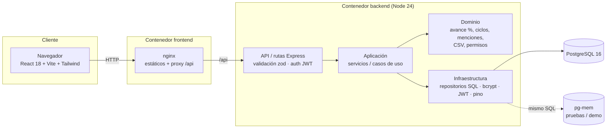

# Gestor de Proyectos

Sistema full-stack para gestionar proyectos de software en equipo: **tablero kanban con drag & drop**, tareas con subtareas y **dependencias sin ciclos**, **registro de horas (timesheet)**, **avance % calculado**, comentarios con **@menciones notificadas**, **carga de trabajo por persona** y **reporte de horas exportable a CSV**. Autorización en dos niveles: rol global (admin, líder, miembro) y rol por proyecto (gestor, colaborador, observador).

> Proyecto de portafolio con enfoque didáctico: el código y la documentación explican el **por qué** de cada decisión.

    

---

## Tabla de contenidos

- [Características](#características)
- [Arquitectura](#arquitectura)
- [Stack y justificación](#stack-y-justificación)
- [Inicio rápido con Docker](#inicio-rápido-con-docker)
- [Inicio sin Docker](#inicio-sin-docker)
- [Credenciales demo](#credenciales-demo)
- [Endpoints principales](#endpoints-principales)
- [Reglas de negocio clave](#reglas-de-negocio-clave)
- [Pruebas](#pruebas)
- [Estructura de carpetas](#estructura-de-carpetas)
- [Variables de entorno](#variables-de-entorno)
- [Qué aprenderás con este proyecto](#qué-aprenderás-con-este-proyecto)
- [Roadmap](#roadmap)
- [Licencia y autor](#licencia-y-autor)

## Características

| Área | Qué incluye |
| --- | --- |
| Proyectos | CRUD, estados (planificado, activo, pausado, cerrado), fechas, avance %, búsqueda, filtros, orden y paginación |
| Miembros | Rol por proyecto (gestor / colaborador / observador); un proyecto nunca se queda sin gestor |
| Tareas | Subtareas (1 nivel), prioridad, etiquetas por proyecto, responsable, horas estimadas, fechas, filtros (vencidas, etiqueta, responsable...) |
| Dependencias | "A depende de B": A no puede pasar a *hecha* si B no lo está; se rechazan ciclos (DFS en el dominio) |
| Kanban | 4 columnas, drag & drop con `@dnd-kit` (también con teclado), actualización optimista con reversión si el backend rechaza |
| Timesheet | Registro de horas por tarea, vista semanal con totales diarios, límite de 24 h/día, sin fechas futuras |
| Colaboración | Comentarios con `@usuario` → se registran en `comment_mentions` y generan notificaciones; asignaciones también notifican |
| Reportes | Dashboard con KPIs, carga de trabajo por persona (nivel baja/normal/alta/sobrecarga), reporte de horas por proyecto en JSON o **CSV** |
| Seguridad | JWT (HS256 fijado), bcrypt, autorización por endpoint y por proyecto, Helmet, CORS, límites de payload, usuarios desactivados pierden acceso al instante |
| Calidad | Arquitectura en capas, DI manual, zod, errores RFC 9457, pino, OpenAPI/Swagger, 77 pruebas backend + 26 frontend, CI en GitHub Actions |
| UI | React 18 + Tailwind, responsive, **modo oscuro**, estados de carga / vacío / error, formularios validados |

## Arquitectura



Detalle de capas, flujo de una petición y decisiones en [`docs/arquitectura.md`](docs/arquitectura.md). Modelo de datos en [`docs/modelo-datos.md`](docs/modelo-datos.md).

## Stack y justificación

| Tecnología | Por qué |
| --- | --- |
| **Node.js 24 + TypeScript** | Tipado estricto de punta a punta; mismo lenguaje en backend y frontend |
| **Express 5** | Mínimo y conocido; la v5 propaga errores de handlers `async` al manejador global sin wrappers |
| **PostgreSQL 16** | Integridad referencial, `ON DELETE CASCADE`, CHECKs; ideal para datos relacionales (proyectos ↔ tareas ↔ horas) |
| **pg (SQL explícito)** | Consultas legibles y optimizables, sin la "magia" de un ORM; se aprende SQL real |
| **pg-mem** | Emula PostgreSQL en memoria: las pruebas de integración ejecutan **las mismas migraciones y el mismo SQL** sin Docker (ver [ADR 002](docs/decisiones/002-pruebas-con-pg-mem.md)) |
| **zod** | Validación declarativa de DTOs y de la configuración al arrancar |
| **JWT + bcryptjs** | Autenticación stateless; bcryptjs es JS puro (no compila binarios en Windows) |
| **pino** | Logs JSON estructurados, rápidos, con redacción de secretos |
| **Swagger UI** | Contrato OpenAPI navegable en `/api/docs` |
| **React 18 + Vite** | SPA rápida de desarrollar; Vite da HMR instantáneo y build optimizado |
| **Tailwind CSS 3** | Diseño consistente y responsive sin CSS suelto; modo oscuro por clase |
| **@dnd-kit** | Drag & drop moderno y accesible (teclado y lectores de pantalla) |
| **Vitest + Supertest + Testing Library** | Un solo runner para backend y frontend; pruebas de API sin abrir puertos |

## Inicio rápido con Docker

Requisitos: Docker con Docker Compose v2.

```bash
cp .env.example .env          # en Windows PowerShell: Copy-Item .env.example .env
docker compose up -d --build
```

| Servicio | URL |
| --- | --- |
| Aplicación web | http://localhost:8080 |
| API | http://localhost:3000/api |
| Swagger / OpenAPI | http://localhost:3000/api/docs |
| Health check | http://localhost:3000/health |

Al arrancar, el backend aplica las migraciones y, con `SEED_DEMO=true`, carga los datos demo si la base está vacía.

## Inicio sin Docker

### Opción A: demo instantánea en memoria (sin instalar PostgreSQL)

```bash
# Terminal 1 - API
cd backend
npm install
cp .env.example .env          # trae DB_DRIVER=memory
npm run dev                   # http://localhost:3000

# Terminal 2 - Web
cd frontend
npm install
npm run dev                   # http://localhost:5173 (proxy /api → :3000)
```

Con `DB_DRIVER=memory` la API usa pg-mem: los datos se pierden al reiniciar, pero no necesitas nada más.

### Opción B: con PostgreSQL local

1. Crea una base `gestor_proyectos` en tu PostgreSQL.
2. En `backend/.env` pon `DB_DRIVER=postgres` y tu `DATABASE_URL`.
3. `npm run db:seed` (aplica migraciones y carga los datos demo) y luego `npm run dev`.

### Build de producción

```bash
cd backend && npm run build && npm start
cd frontend && npm run build   # genera frontend/dist
```

## Credenciales demo

Todos los datos son **ficticios**. Contraseña para todos: `Demo123!`

| Correo | Rol global | Para probar |
| --- | --- | --- |
| `admin@demo.pe` | admin | Ve todo, gestiona usuarios, elimina proyectos |
| `lider@demo.pe` (Lucía) | lider | Crea proyectos, gestora de "Portal de clientes", carga de trabajo, reporte CSV |
| `miembro@demo.pe` (Mario) | miembro | Colaborador: mueve tareas en el kanban, registra horas, comenta |
| `carla@demo.pe`, `diego@demo.pe` | miembro | Diego es *observador* en un proyecto (solo ve y comenta) |
| `sofia@demo.pe` | lider | Gestora de "App móvil Sabor Limeño" |

Prueba rápida de reglas: entra como Lucía, abre "Portal de clientes" e intenta arrastrar **"Despliegue a producción"** a *Hecha*: el backend lo rechaza porque depende de tareas abiertas y la tarjeta vuelve a su lugar.

## Endpoints principales

Todas las rutas (salvo login y health) requieren `Authorization: Bearer <token>`. Ejemplos `curl` en [`docs/guia-api.md`](docs/guia-api.md).

| Método | Ruta | Descripción | Quién |
| --- | --- | --- | --- |
| POST | `/api/auth/login` | Inicia sesión, devuelve JWT | Público |
| GET | `/api/auth/me` | Usuario actual | Autenticado |
| GET / POST / PATCH | `/api/users[/:id]` | Directorio / alta / edición de usuarios | Listar: todos · Crear/editar: admin |
| GET | `/api/dashboard` | KPIs del usuario | Autenticado |
| GET | `/api/reports/workload` | Carga de trabajo por persona | admin, lider |
| GET / POST | `/api/projects` | Listar (paginado, filtros, orden) / crear | Crear: admin, lider |
| GET / PATCH / DELETE | `/api/projects/:id` | Detalle con avance / editar / eliminar | Ver: miembro · Editar: gestor · Eliminar: admin |
| GET / POST / PATCH / DELETE | `/api/projects/:id/members[/:userId]` | Miembros y rol por proyecto | Gestionar: gestor |
| GET / POST | `/api/projects/:id/labels` | Etiquetas del proyecto | Crear: gestor |
| GET / POST | `/api/projects/:id/tasks` | Listar tareas (filtros) / crear tarea o subtarea | Crear: gestor, colaborador |
| GET | `/api/projects/:id/board` | Tablero kanban | Miembros |
| GET | `/api/projects/:id/reports/hours?format=csv` | Reporte de horas JSON / CSV | gestor |
| GET / PATCH / DELETE | `/api/tasks/:id` | Detalle (subtareas, dependencias, avance) / editar / eliminar | Eliminar: gestor |
| POST | `/api/tasks/:id/move` | Mover en el kanban (estado + posición) | gestor, colaborador |
| POST / DELETE | `/api/tasks/:id/dependencies[/:dependsOnId]` | Dependencias (sin ciclos) | gestor, colaborador |
| GET / POST | `/api/tasks/:id/comments` | Comentarios con @menciones | Comentar: incluye observador |
| GET / POST | `/api/tasks/:id/time-entries` | Horas de la tarea / registrar horas | Registrar: gestor, colaborador |
| GET / DELETE | `/api/time-entries[/:id]` | Mi timesheet / borrar registro | Propio o gestor |
| GET / POST | `/api/notifications`, `/:id/read`, `/read-all` | Notificaciones | Destinatario |
| GET | `/health`, `/api/docs`, `/api/openapi.json` | Salud y documentación | Público |

Los errores siguen **RFC 9457 (Problem Details)**:

```json
{
  "type": "urn:gestor-proyectos:error:dependencies_pending",
  "title": "Regla de negocio incumplida",
  "status": 422,
  "detail": "No se puede completar: depende de 3 tarea(s) sin terminar",
  "instance": "/api/tasks/10",
  "code": "dependencies_pending",
  "traceId": "9b1f...",
  "errors": [{ "id": 3, "title": "Pantalla de seguimiento de envíos", "status": "en_progreso" }]
}
```

## Reglas de negocio clave

**Avance %** (implementado en [`backend/src/domain/progress.ts`](backend/src/domain/progress.ts)):

1. Tarea sin subtareas: `pendiente = 0`, `en_progreso = 0.5`, `en_revision = 0.8`, `hecha = 1`.
2. Tarea con subtareas: promedio de sus subtareas **ponderado por horas estimadas**.
3. Proyecto: promedio ponderado de sus tareas de primer nivel.
4. Peso = horas estimadas, o 1 si la tarea no está estimada.

Ejemplo: tarea A (30 h, hecha) y tarea B (10 h, pendiente) → `(1·30 + 0·10) / 40 = 75 %`.

**Dependencias**: no se puede pasar a *hecha* con dependencias abiertas (`422 dependencies_pending`); agregar una dependencia que cierre un ciclo devuelve `422 dependency_cycle`; solo dentro del mismo proyecto.

**Subtareas**: un solo nivel; el padre no se cierra con subtareas abiertas; una subtarea no se reabre si el padre está cerrado.

**Menciones**: `@usuario` (no correos); solo se registran y notifican miembros del proyecto; los demás vuelven en `ignoredMentions`.

**Horas**: sin fechas futuras, máximo 24 h por persona y día, cada uno borra lo suyo (el gestor puede borrar cualquiera del proyecto).

**Miembros**: un proyecto siempre conserva al menos un gestor; un admin no puede quitarse su propio rol.

## Pruebas

```bash
cd backend && npm test        # 77 pruebas: unitarias de dominio + integración de la API (pg-mem, sin Docker)
cd frontend && npm test       # 26 pruebas: utilidades, componentes, cliente API y login
```

- **Unitarias (dominio)**: avance %, ciclos de dependencias, menciones, CSV (escape e inyección de fórmulas), matriz de permisos, fechas y nivel de carga.
- **Integración (API)**: login y 401, validación 400, permisos 403 por rol global y por proyecto, paginación/filtros/orden, reglas de dependencias y subtareas, kanban, menciones + notificaciones, timesheet, CSV, carga de trabajo, dashboard, gestión de usuarios.
- **Frontend**: lógica del kanban optimista (`moveCard`), formato, validaciones, componentes (`Pagination`, `ErrorState`, `TaskCard`...) y flujo de login con `fetch` simulado.

Además: `npm run lint`, `npm run typecheck` (backend) y `npm run build` en ambos. La CI ([`.github/workflows/ci.yml`](.github/workflows/ci.yml)) ejecuta todo en Node 24 y valida el `docker-compose.yml`.

## Estructura de carpetas

```
gestor-proyectos/
├── backend/
│   ├── migrations/               # SQL versionado (001_esquema_inicial.sql)
│   ├── src/
│   │   ├── domain/               # Reglas puras: progreso, dependencias, menciones, CSV, permisos, fechas
│   │   ├── application/          # Casos de uso (services/), DTOs zod y puertos (interfaces de repositorios)
│   │   ├── infrastructure/       # Repositorios SQL, BD (pg / pg-mem), migraciones, seed, bcrypt, JWT, logger
│   │   ├── api/                  # Rutas Express, middlewares (auth, errores), OpenAPI
│   │   ├── config/env.ts         # Configuración validada con zod
│   │   ├── container.ts          # Raíz de composición (inyección de dependencias manual)
│   │   ├── app.ts                # Construye la app Express (usada por main y por las pruebas)
│   │   └── main.ts               # Arranque: migra, siembra, escucha y apagado ordenado
│   ├── tests/unit | integration
│   └── Dockerfile                # Multi-stage, usuario no root
├── frontend/
│   ├── src/
│   │   ├── api/                  # Cliente fetch (token, Problem Details), endpoints tipados, tipos
│   │   ├── components/           # UI base, layout con sidebar, Kanban, modales de tareas
│   │   ├── context/              # Auth, tema oscuro, toasts
│   │   ├── hooks/                # useAsync (sin condiciones de carrera), useDebounce
│   │   ├── lib/                  # Lógica pura testeable: board, formato, menciones, validación, semana
│   │   ├── pages/                # Login, Dashboard, Proyectos, Detalle, Timesheet, Carga, Notificaciones, Usuarios
│   │   └── test/                 # Pruebas de componentes y setup
│   ├── nginx.conf                # SPA + proxy /api → backend
│   └── Dockerfile                # Build + nginx sin privilegios
├── docs/                         # Arquitectura, modelo de datos, guía de API y ADRs
├── docker-compose.yml
└── .github/workflows/ci.yml
```

## Variables de entorno

Raíz (`.env`, usado por docker compose):

| Variable | Ejemplo | Descripción |
| --- | --- | --- |
| `POSTGRES_DB` / `POSTGRES_USER` / `POSTGRES_PASSWORD` | `gestor_proyectos` / `gestor` / `cambia_esta_clave` | Credenciales de PostgreSQL |
| `JWT_SECRET` | cadena larga aleatoria | Firma de tokens (mín. 16 caracteres) |
| `JWT_EXPIRES_IN` | `8h` | Vigencia del token |
| `BCRYPT_ROUNDS` | `10` | Costo de bcrypt (4-15) |
| `LOG_LEVEL` | `info` | Nivel de pino |
| `CORS_ORIGIN` | `http://localhost:8080` | Orígenes permitidos (separados por coma) |
| `SEED_DEMO` | `true` | Carga datos demo si la BD está vacía |
| `API_PORT` / `WEB_PORT` | `3000` / `8080` | Puertos publicados |

Backend sin Docker (`backend/.env`): además `NODE_ENV`, `PORT`, `DB_DRIVER` (`postgres` | `memory`) y `DATABASE_URL`. Ver [`backend/.env.example`](backend/.env.example).

Frontend: `VITE_API_URL` (opcional, por defecto `/api`) y `VITE_PROXY_TARGET` (destino del proxy de desarrollo, por defecto `http://localhost:3000`).

## Qué aprenderás con este proyecto

- **Arquitectura en capas real**: por qué el dominio no importa Express ni SQL, y cómo eso permite probar reglas con funciones puras.
- **Inyección de dependencias sin frameworks**: un `container.ts` explícito como raíz de composición.
- **Autorización en dos niveles**: rol global + rol por proyecto expresados como una matriz de permisos testeable.
- **Algoritmos aplicados**: detección de ciclos en un grafo dirigido (DFS) y promedios ponderados para el avance.
- **Diseño de APIs**: paginación, filtros, orden con lista blanca (sin SQL injection), códigos HTTP correctos (400/401/403/404/409/422) y Problem Details.
- **SQL sin ORM**: agregaciones, tablas derivadas, evitar N+1 con hidratación por lotes, migraciones versionadas.
- **Pruebas sin Docker**: integración contra un PostgreSQL emulado con pg-mem y reloj inyectable para resultados deterministas.
- **Seguridad práctica**: bcrypt, JWT con algoritmo fijado, mitigación de enumeración de usuarios por tiempos, CSV injection, redacción de secretos en logs.
- **Frontend profesional**: drag & drop accesible con actualización optimista y reversión, manejo centralizado de errores, modo oscuro sin parpadeo.
- **DevOps**: Dockerfiles multi-stage con usuarios no root, nginx como reverse proxy, CI con GitHub Actions.

## Roadmap

- [ ] Notificaciones en tiempo real (WebSocket / SSE) y por correo.
- [ ] Refresh tokens con rotación y revocación.
- [ ] Diagrama de Gantt usando fechas y dependencias.
- [ ] Adjuntos en tareas (almacenamiento S3 compatible).
- [ ] Historial de actividad (auditoría de cambios por tarea).
- [ ] Capacidad semanal configurable por persona y feriados de Perú.
- [ ] Pruebas E2E con Playwright.
- [ ] Internacionalización (es / en).

## Licencia y autor

Distribuido bajo licencia **MIT** — ver [`LICENSE`](LICENSE).

**Angel Castañeda Meza** — Ingeniero de Sistemas, Lima, Perú.
GitHub: [@angel-cm-dev](https://github.com/angel-cm-dev)
