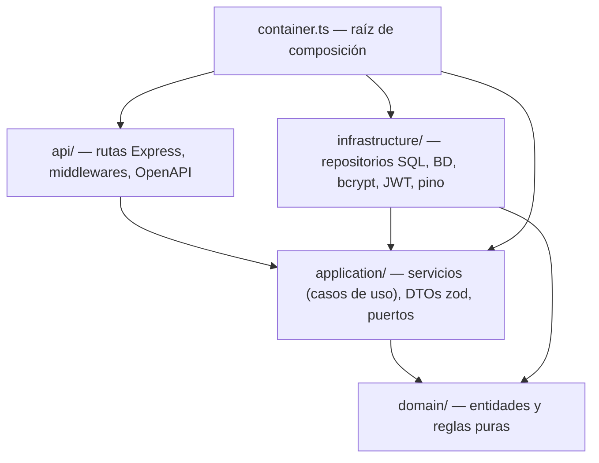
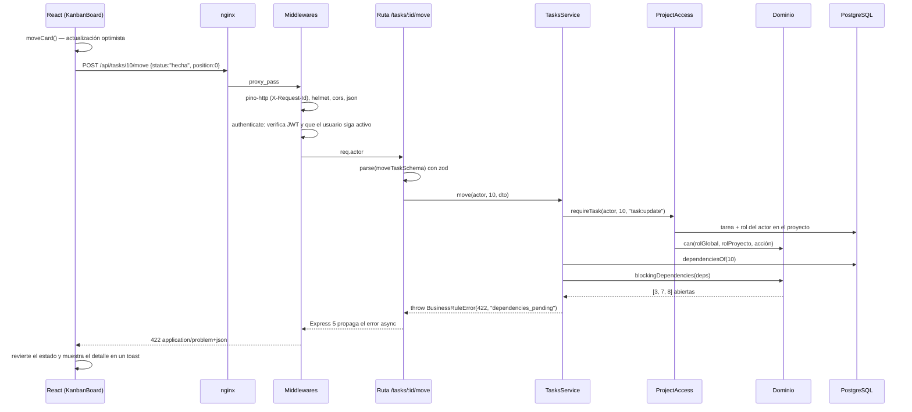

# Arquitectura

## Visión general

El backend sigue una **arquitectura en capas** con la regla de dependencia apuntando hacia adentro: las capas externas conocen a las internas, nunca al revés.



| Capa | Responsabilidad | Ejemplos | Conoce a |
| --- | --- | --- | --- |
| **Dominio** | Reglas del negocio como funciones puras | `computeProgress`, `wouldCreateCycle`, `extractMentions`, `toCsv`, `can()` | Nadie |
| **Aplicación** | Orquesta casos de uso: carga datos vía puertos, aplica reglas, persiste | `TasksService.move`, `CommentsService.create` | Dominio + interfaces (`ports.ts`) |
| **Infraestructura** | Implementa los puertos con tecnología concreta | `PgTaskRepository`, `BcryptPasswordHasher`, `JwtTokenService` | Aplicación (interfaces) + dominio |
| **API** | Traduce HTTP ⇄ casos de uso: valida, autentica, serializa | `routes/index.ts`, `middleware/auth.ts` | Aplicación |

**Por qué así:** las reglas más valiosas (avance, ciclos, permisos) se prueban en milisegundos sin base de datos ni servidor, y cambiar PostgreSQL por otro motor solo afecta a `infrastructure/`.

## Inyección de dependencias

`src/container.ts` es el **único** lugar con `new` de clases concretas. Los servicios reciben interfaces por constructor:

```ts
const access = new ProjectAccess(repos.projects, repos.tasks);
const tasks = new TasksService(repos.tasks, repos.projects, repos.time, repos.notifications, access, clock);
```

Las pruebas crean el mismo contenedor con otra BD (pg-mem) y un **reloj fijo** (`Clock`), lo que vuelve deterministas reglas que dependen de "hoy" (horas a futuro, tareas vencidas).

## Flujo de una petición

Ejemplo: mover una tarjeta a "Hecha" en el kanban.



## Manejo de errores

- Las capas internas lanzan subclases de `AppError` (`NotFoundError`, `ForbiddenError`, `BusinessRuleError`...) sin conocer HTTP.
- `middleware/error-handler.ts` las traduce a **RFC 9457 Problem Details** con `code` estable, `traceId` (correlaciona con los logs) y `errors` (detalle por campo o tareas bloqueantes).
- Errores de PostgreSQL que escapan a las validaciones (23505 / 23503) se convierten en 409.
- Errores inesperados → 500 genérico; el detalle completo solo va al log.

Códigos usados: `400` forma inválida (zod) · `401` sin token / token inválido / usuario inactivo · `403` rol insuficiente · `404` no existe · `409` duplicado / conflicto · `422` regla de negocio.

## Autorización

Dos niveles combinados en `domain/permissions.ts`:

1. **Endpoint (rol global)** con `requireRole('admin', 'lider')` — p. ej. crear proyectos o ver la carga de trabajo.
2. **Proyecto (rol por proyecto)** con `ProjectAccess.requireProject/requireTask` — p. ej. un "miembro" global que es *gestor* de un proyecto puede administrarlo.

| Acción | gestor | colaborador | observador |
| --- | :-: | :-: | :-: |
| Ver proyecto, tablero, tareas | ✔ | ✔ | ✔ |
| Comentar | ✔ | ✔ | ✔ |
| Crear / editar / mover tareas, dependencias | ✔ | ✔ | |
| Registrar horas | ✔ | ✔ | |
| Eliminar tareas, gestionar miembros y etiquetas | ✔ | | |
| Ver reporte de horas / borrar horas ajenas | ✔ | | |
| Eliminar proyecto | solo admin global | | |

El admin global puede todo aunque no sea miembro. Un líder ve la carga de trabajo solo de los proyectos donde es gestor.

## Fórmula del avance %

Ver `domain/progress.ts`:

```
progresoHoja(t)    = { pendiente: 0, en_progreso: 0.5, en_revision: 0.8, hecha: 1 }[t.estado]
progresoTarea(t)   = 1                                      si t está hecha
                   = Σ progresoHoja(s)·peso(s) / Σ peso(s)  si t tiene subtareas s
                   = progresoHoja(t)                        en otro caso
progresoProyecto   = Σ progresoTarea(t)·peso(t) / Σ peso(t)  sobre tareas de primer nivel
peso(t)            = horasEstimadas(t) si > 0, si no 1
```

Decisiones: los estados intermedios valen algo (reflejan esfuerzo real) pero nunca 100 %; ponderar por horas evita que diez tareas triviales "pesen" lo mismo que una épica.

## Kanban y orden

- Cada tarea de primer nivel tiene `position` dentro de su columna (estado).
- `POST /tasks/:id/move` inserta la tarea en el índice pedido de la columna destino y renumera 0..n-1, escribiendo solo las filas que cambian.
- Las reglas de estado son **las mismas** que en `PATCH /tasks/:id`: el tablero no es un atajo para saltarse dependencias.
- El frontend aplica el movimiento de forma optimista con la función pura `moveCard` y revierte si la API responde error.

## Decisiones relevantes

- [ADR 001 — Arquitectura en capas con DI manual](decisiones/001-arquitectura-en-capas.md)
- [ADR 002 — Pruebas de integración con pg-mem](decisiones/002-pruebas-con-pg-mem.md)
- [ADR 003 — Errores con Problem Details y 422 para reglas de negocio](decisiones/003-problem-details.md)

Otras:
- **SQL explícito sin ORM**: control total de consultas; los filtros dinámicos usan parámetros `$n` y las columnas de orden salen de una **lista blanca**.
- **Hidratación por lotes**: etiquetas y dependencias de una página de tareas se cargan con 2 consultas `IN (...)`, evitando N+1.
- **Ciclos detectados en la aplicación** (DFS) y no con CTE recursiva: el grafo de un proyecto es pequeño, la lógica queda testeable y es portable a pg-mem.
- **Usuario desactivado = acceso revocado**: cada petición verifica en BD que el usuario siga activo, aunque su JWT no haya expirado.
