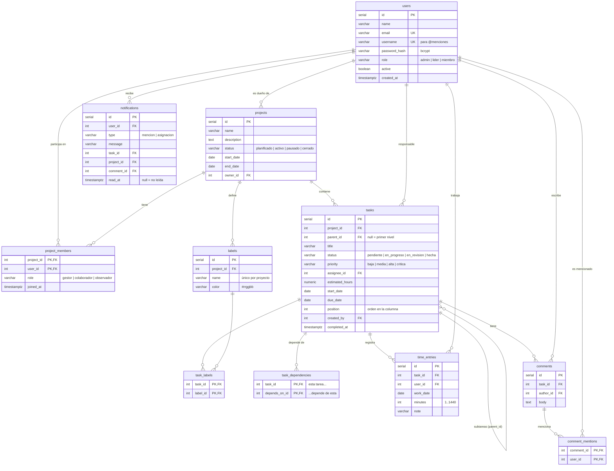

# Modelo de datos

Esquema definido en [`backend/migrations/001_esquema_inicial.sql`](../backend/migrations/001_esquema_inicial.sql). Compatible con PostgreSQL 16 y con pg-mem (pruebas).

## Tablas

| Tabla | Propósito | Notas de diseño |
| --- | --- | --- |
| `users` | Cuentas del sistema | `email` y `username` únicos (normalizados a minúsculas). `active=false` revoca el acceso sin borrar historial |
| `projects` | Proyectos | `owner_id` = creador. `updated_at` se actualiza en cada edición |
| `project_members` | Rol **por proyecto** | PK compuesta evita membresías duplicadas. Índice por `user_id` para "mis proyectos" |
| `labels` | Etiquetas propias de cada proyecto | `UNIQUE(project_id, name)`; se borran en cascada con el proyecto |
| `tasks` | Tareas y subtareas | `parent_id` autorreferencia (un nivel, regla en el servicio). `position` ordena la columna del kanban. `completed_at` alimenta "terminadas en 7 días" |
| `task_labels` | N:M tareas ↔ etiquetas | |
| `task_dependencies` | Grafo dirigido de dependencias | `CHECK (task_id <> depends_on_id)` evita autodependencia; los ciclos más largos se validan en el dominio |
| `time_entries` | Timesheet | Minutos enteros (evita errores de redondeo con decimales). `CHECK 1..1440`. Índice `(user_id, work_date)` para el límite diario y la vista semanal |
| `comments` | Comentarios de tareas | |
| `comment_mentions` | Registro de menciones | Permite saber a quién se mencionó aunque el texto se edite en el futuro |
| `notifications` | Bandeja de cada usuario | `read_at` nulo = no leída. Índice `(user_id, read_at)` para contar no leídas rápido |
| `schema_migrations` | Control de migraciones aplicadas | La crea el ejecutor de migraciones |

## Integridad referencial

- Borrar un **proyecto** elimina en cascada miembros, etiquetas, tareas y, por ende, horas, comentarios y notificaciones asociadas.
- Borrar una **tarea** elimina sus subtareas, dependencias, horas y comentarios.
- Si se borra un usuario responsable, `assignee_id` pasa a `NULL` (`ON DELETE SET NULL`); en la práctica los usuarios se **desactivan**, no se borran.

## ¿Por qué `VARCHAR + CHECK` y no `ENUM`?

Los `CHECK` son igual de seguros, más fáciles de modificar en una migración (agregar un estado no requiere `ALTER TYPE`) y funcionan en pg-mem, lo que permite que las pruebas ejecuten exactamente el mismo esquema que producción.
